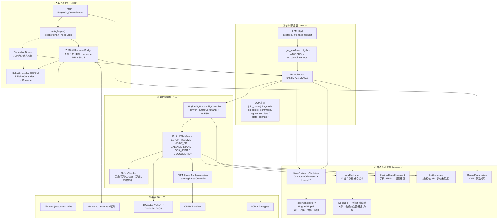
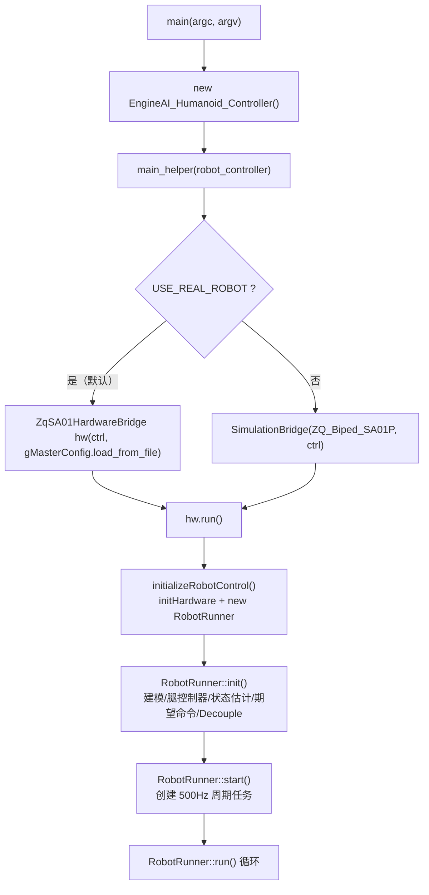
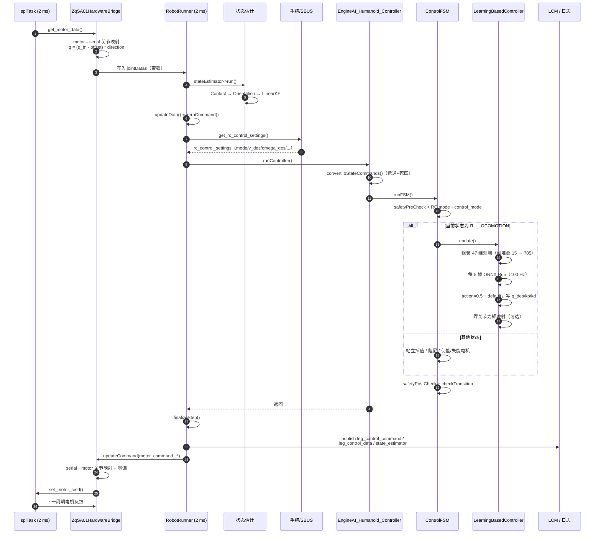
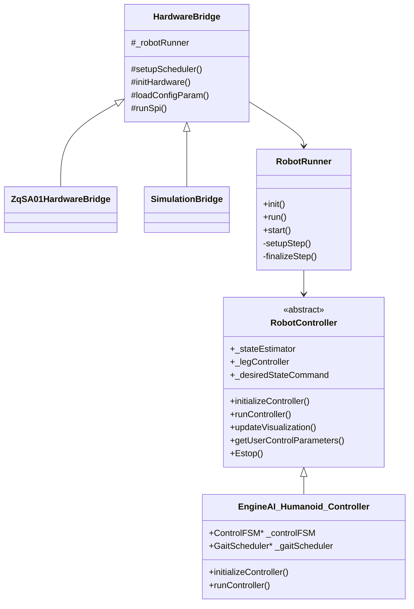
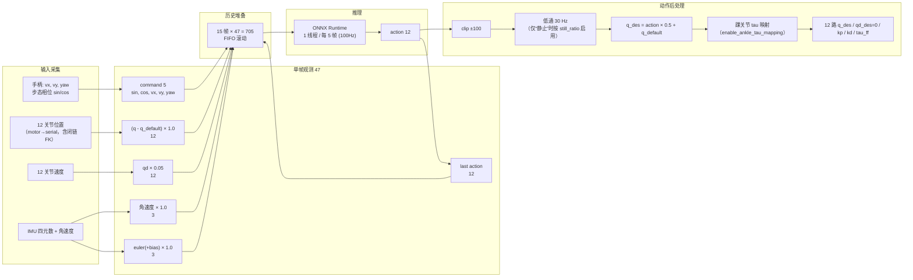
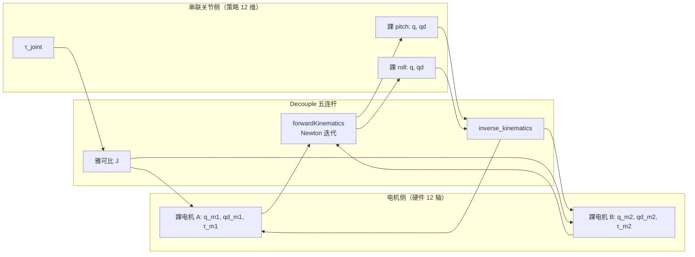
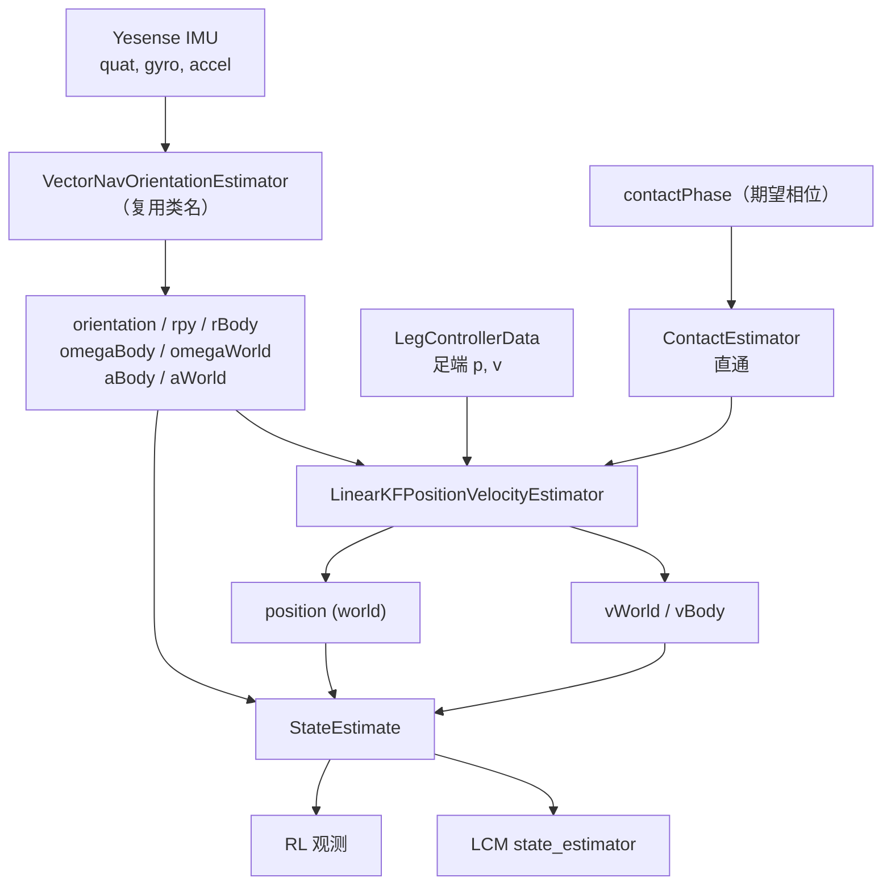

# engineai_humanoid 代码架构详解

> 本文面向二次开发者，系统梳理 `engineai_humanoid` 仓库的模块划分、运行时架构、控制回路、RL 策略部署链路、状态估计、闭链映射、LCM 通信与部署方式。
>
> 仓库定位：EngineAI（深圳引擎人形机器人）双足机器人 **运动控制（locomotion）** 仓库，框架源自 MIT Cheetah-Software，当前开源的落地能力是 **强化学习策略真机部署**；基于模型的规划/控制模块（MPC/WBC 等）仍在开发中、尚未开源。

---

## 目录

- [1. 总览](#1-总览)
- [2. 仓库目录结构](#2-仓库目录结构)
- [3. 总体架构](#3-总体架构)
- [4. 启动链路](#4-启动链路)
- [5. 实时控制回路（一个 2 ms 周期）](#5-实时控制回路一个-2-ms-周期)
- [6. 线程模型与实时性](#6-线程模型与实时性)
- [7. robot 模块：硬件桥接与调度](#7-robot-模块硬件桥接与调度)
- [8. user 模块：控制器、FSM 与安全](#8-user-模块控制器fsm-与安全)
- [9. RL_Controller：强化学习策略部署](#9-rl_controller强化学习策略部署)
- [10. common 模块：算法基础设施](#10-common-模块算法基础设施)
- [11. 闭链踝关节映射](#11-闭链踝关节映射)
- [12. 状态估计数据流](#12-状态估计数据流)
- [13. 配置体系](#13-配置体系)
- [14. LCM 通信与日志](#14-lcm-通信与日志)
- [15. third-party 模块](#15-third-party-模块)
- [16. 依赖与构建产物](#16-依赖与构建产物)
- [17. 部署与运行](#17-部署与运行)
- [18. 已知限制与常见坑](#18-已知限制与常见坑)
- [19. 二次开发指南](#19-二次开发指南)

---

## 1. 总览

### 1.1 关键事实

| 项目     | 说明                                                            |
| ------ | ------------------------------------------------------------- |
| 语言/标准  | C++14                                                         |
| 构建系统   | CMake（顶层要求 ≥ 3.5，ONNX 相关子工程要求 ≥ 3.10；README 建议 3.26+）         |
| 控制频率   | 主循环 500 Hz（`controller_dt = 0.002 s`）                         |
| 策略推理频率 | 100 Hz（`decimation = 5`，每 5 个控制周期推理一次）                        |
| 策略格式   | ONNX（`policy/zqsa01/zqsa01_policy.onnx`）                      |
| 推理引擎   | ONNX Runtime（1.19.0 推荐）                                       |
| 机器人型号  | `RobotType::ZQ_Biped_SA01P`（`buildEngineAIRobot<float>()` 固定） |
| 关节数    | 12 个驱动关节（单腿 6：髋 roll/yaw/pitch、膝 pitch、踝 2 电机闭链）              |
| 状态估计   | IMU 姿态 + 12 状态线性卡尔曼滤波（位置/速度）                                  |
| 真机接口   | `libmotor`（SPI/电机 MCU）+ Yesense IMU + SBUS/Logitech 手柄        |
| 遥测     | LCM（内部线程间 + 上位机 `lcm-spy`）                                    |
| 运行平台   | 机器人主板 NeZha/NaZha（Ubuntu 20.04），本地交叉编译后拷贝                     |

### 1.2 三种使用路径

1. **真机部署（默认）**：`#define USE_REAL_ROBOT` 打开，走 `ZqSA01HardwareBridge`。
2. **仿真桥接**：关闭该宏后走 `SimulationBridge`（共享内存版本，配合外部仿真器），当前仓库内默认不启用。
3. **纯算法调试**：`RobotRunner` 内保留 `JointControlTestwithYAML()`、`CloseChainMappingTest()` 等调试入口。

---

## 2. 仓库目录结构

```text
engineai_humanoid/
├── README.md                     # 依赖、编译、真机部署、手柄说明
├── dep-pkgs/
│   └── motor-mcu_1.0.8_amd64.deb # 电机 MCU 用户态 API（libmotor）+ README
└── EngineAI_Controller/
    ├── CMakeLists.txt            # 顶层构建：robot/third-party/common/user
    ├── config.h.cmake            # 生成 Configuration.h（THIS_COM 等）
    ├── EngineAI_Controller.cpp   # main()
    ├── config/
    │   ├── zqsa01-robot-default-param.yaml  # 电机/站立/滤波/控制模式
    │   └── simulator-defaults.yaml          # 仿真默认参数（桥接用）
    ├── lcm-types/                # .lcm 定义 + 生成代码（cpp/java/python）
    ├── scripts/                  # 启动、组播网络、lcm-spy、clang-format
    ├── third-party/              # QP/OSQP/SOEM/ParamHandler/IMU/手柄等
    ├── common/                   # 与硬件无关的算法库 common_module
    │   ├── include/Controllers/  # LegController、状态估计、期望命令、步态
    │   ├── include/Dynamics/     # 机器人建模、连杆/关节参数
    │   ├── include/ControlParameters/
    │   ├── include/Utilities/    # 数学、滤波、可视化、碰撞等
    │   └── src/...
    ├── robot/                    # 硬件/仿真桥接与 500Hz 调度 robot.so
    │   ├── include/RobotRunner.h, HardwareBridge.h, RobotController.h
    │   ├── include/rt/           # rc_interface、sbus 遥测
    │   └── src/...
    └── user/
        └── EngineAI_Humanoid_Controller/
            ├── EngineAI_Humanoid_Controller.{h,cpp}
            ├── EngineAI_UserParameters.h
            ├── FSM_States/       # ControlFSM + 6 个状态 + SafetyChecker
            └── Controllers/RL_Controller/
                ├── include/, src/  # LearningBasedController
                ├── config/zqsa01_rl.yaml
                └── policy/zqsa01/zqsa01_policy.onnx
```

### 2.1 模块与库的对应关系

| 模块                       | 产物                                   | 职责                                                                                           |
| ------------------------ | ------------------------------------ | -------------------------------------------------------------------------------------------- |
| `common`                 | `libcommon_module.so`                | 动力学/运动学建模、腿控制器、状态估计、期望命令、步态调度、闭链映射、参数框架、工具函数                                                 |
| `robot`                  | `librobot.so`                        | 实时调度、真机/仿真桥接、电机-关节映射、IMU/SBUS/手柄、LCM 发布                                                      |
| `user`                   | `libengineai_humanoid_controller.so` | 具体机器人的控制器、FSM、安全检查和 RL 状态                                                                    |
| `user/.../RL_Controller` | `librl_controllers.so`               | ONNX 推理、观测构造、动作后处理、偏差校准、踝关节力矩映射                                                              |
| 顶层                       | 可执行 `EngineAI_Controller`            | `main()`，把控制器交给 `main_helper`                                                                |
| `third-party`            | 各静态/动态库                              | qpOASES/OSQP/Goldfarb/JCQP（优化）、SOEM（EtherCAT）、ParamHandler/inih（参数）、vectornav/yesense（IMU）、7 |

---

## 3. 总体架构

### 3.1 分层架构图（Mermaid）



### 3.2 同构 ASCII 图

```text
┌──────────────────────────────────────────────────────────────────────────┐
│ ⑤ 平台层                                                                 │
│   libmotor(SPI电机MCU)   Yesense IMU   LCM   ONNX Runtime   第三方优化库   │
└──────────────▲───────────────────────────────────────────────▲──────────┘
               │ motor_data / motor_cmd                        │ Tensor
┌──────────────┴───────────────────────────────────────────────┴──────────┐
│ ④ robot 桥接 + 调度层                                                     │
│  ZqSA01HardwareBridge ──► RobotRunner (500Hz) ──► LCM 发布/订阅           │
│    spiTask 2ms / sbusTask 100ms / statusTask 500ms                       │
└──────────────▲───────────────────────────────────────────────┬──────────┘
               │ runController()                                │ leg_control_data_biped
┌──────────────┴───────────────────────────────────────────────▼──────────┐
│ ③ user 控制层                                                             │
│  EngineAI_Humanoid_Controller                                            │
│    ├─ DesiredStateCommand.convertToStateCommands()  ← 手柄/SBUS          │
│    └─ ControlFSM.runFSM()                                                │
│         ESTOP/PASSIVE/JOINT_PD/BALANCE_STAND/LOCK_JOINT/RL_LOCOMOTION    │
│         └─ FSM_State_RL_Locomotion ──► LearningBasedController (ONNX)    │
└──────────────▲───────────────────────────────────────────────┬──────────┘
               │ 估计状态/腿数据                                 │ 期望关节位置/力矩
┌──────────────┴───────────────────────────────────────────────▼──────────┐
│ ④ common 算法层                                                           │
│  状态估计(IMU+KF)  LegController  闭链映射 Decouple  RobotConstructor     │
│  DesiredStateCommand  GaitScheduler  ControlParameters  Utilities        │
└──────────────────────────────────────────────────────────────────────────┘
```

---

## 4. 启动链路

### 4.1 流程图



### 4.2 入口代码

```cpp
// EngineAI_Controller.cpp
int main(int argc, char **argv) {
  RobotController *robot_controller = new EngineAI_Humanoid_Controller();
  main_helper(robot_controller);
}
```

```cpp
// robot/src/main_helper.cpp（关键分支）
#define USE_REAL_ROBOT
#ifdef USE_REAL_ROBOT
  ZqSA01HardwareBridge hw(robot_controller, gMasterConfig.load_from_file);
  hw.run();
#else
  SimulationBridge bridge(gMasterConfig._robot, robot_controller);
  bridge.run();
#endif
```

`RobotController` 是抽象基类（`robot/include/RobotController.h`），只定义：

- `initializeController()`
- `runController()`
- `updateVisualization()`
- `getUserControlParameters()`
- `Estop()`
- 共享指针 `_stateEstimator`、`_legController`、`_desiredStateCommand`、`_humanoid_biped` 等

上层桥接层只依赖这个接口，因此 user 层可以替换为新控制器而不改硬件层。

---

## 5. 实时控制回路（一个 2 ms 周期）

### 5.1 时序图



### 5.2 文字版一周期

```text
[spiTask @500Hz] 读电机反馈 → 换算成“串联关节”角度/速度/力矩 → jointDatas
        │
        ▼
[RobotRunner::run @500Hz]
  1) _stateEstimator->run()                  // IMU 姿态 + 足端/IMU 融合的位置速度
  2) 计时统计
  3) setupStep()
       - _legController->updateData(jointDatas)
       - zeroCommand()
       - setEnabled(true)
       - get_rc_control_settings(&rc_control)
       - 前 10 个周期禁用腿（保护）
  4) _robot_ctrl->runController()
       - DesiredStateCommand 更新
       - ControlFSM 运行（可能执行 RL 推理）
  5) finalizeStep()
       - _legController->updateCommand(jointCmd)  // 关节命令 → motor_command_t
       - 发布 leg_control_command / leg_control_data / state_estimator
        │
        ▼
[spiTask] motor_command_t → 电机侧 q_des/零偏 → set_motor_cmd() → SPI 下发
```

### 5.3 关键时间参数

| 参数              | 值                                   | 位置                                       |
| --------------- | ----------------------------------- | ---------------------------------------- |
| `controller_dt` | 0.002 s（500 Hz）                     | `config/zqsa01-robot-default-param.yaml` |
| spiTask 周期      | 2 ms                                | `HardwareBridge.cpp`                     |
| sbusTask 周期     | 100 ms                              | `HardwareBridge.cpp`                     |
| statusTask 周期   | 500 ms                              | `HardwareBridge.cpp`                     |
| 策略 decimation   | 5（→100 Hz）                          | `user/.../config/zqsa01_rl.yaml`         |
| 策略帧堆叠           | 15 帧（100 Hz 下约 150 ms 历史；47×15=705） | 同上                                       |
| 起步保护            | 前 10 个控制周期腿失能                       | `RobotRunner.cpp`                        |

---

## 6. 线程模型与实时性

| 线程 / 任务                                   | 周期      | 优先级                             | 主要工作                                           |
| ----------------------------------------- | ------- | ------------------------------- | ---------------------------------------------- |
| `robot-control`（RobotRunner PeriodicTask） | 2 ms    | SCHED_FIFO 49（`setupScheduler`） | 状态估计、FSM、RL 推理、LCM 发布                          |
| `spiTask`                                 | 2 ms    | 继承/实时                           | `runSpi()`：读电机、写命令、发布 `joint_data`/`joint_cmd` |
| `sbusTask`                                | 100 ms  | 普通                              | 读 SBUS/手柄，更新 `rc_control`                      |
| `statusTask`                              | 500 ms  | 普通                              | 打印状态/诊断                                        |
| 主线程                                       | 10 s 循环 | 普通                              | 保活，等待任务退出                                      |
| LCM 回调                                    | 事件驱动    | 普通                              | `interface`、`interface_request` 订阅             |

实时性措施：

- `setupScheduler()` 设置 `SCHED_FIFO`，优先级 49；
- `prefaultStack()` / `mlockall`（代码中保留，部分调用被注释，需按部署环境确认）；
- 主循环内避免动态内存分配（容器在 `init()` 阶段预分配）；
- ONNX Runtime 会话配置 `intra_op_num_threads = 1`，避免线程争抢。

---

## 7. robot 模块：硬件桥接与调度

### 7.1 类关系



### 7.2 RobotRunner

`robot/src/RobotRunner.cpp` 是整个控制的数据总线：

- `init()`：
  - `buildEngineAIRobot<float>()` → `buildModel()`（质量、惯量、连杆、腿长、髋位置）；
  - 创建 `LegController<float>`；
  - 创建 `StateEstimatorContainer<float>`，按顺序加入：
    1. `ContactEstimator<float>`（把期望接触相位直接作为估计）
    2. `VectorNavOrientationEstimator<float>`（IMU 姿态；真机上由 Yesense 数据填充）
    3. `LinearKFPositionVelocityEstimator<float>`（位置/速度）
  - 创建 `DesiredStateCommand<float>`；
  - 把上述指针写回 `RobotController`；
  - 创建 `Decouple`（闭链映射对象）。
- `run()`：
  - 状态估计 → 计时 → `setupStep()` →（前 10 周期保护）→ `runController()` → `finalizeStep()`。
- `finalizeStep()`：
  - `_legController->updateCommand(jointCommand)` 把 `leg_control_data_biped` 拷贝成 12 路 `motor_command_t`；
  - 发布 LCM：`leg_control_command`、`leg_control_data`、`state_estimator`。
- 调试入口：
  - `JointControlTestwithYAML()`：按 YAML 中 `leg_0..3_*` 做单关节正弦测试；
  - `CloseChainMappingTest()`：验证 `Decouple` 的正/逆运动学一致性。

### 7.3 ZqSA01HardwareBridge

- `initHardware()`：
  - `motor_init()`（打开 `/dev/spidev1.0`、`/dev/spidev1.1`）；
  - `new yesense::YesenseDriver()`（IMU）；
  - `init_sbus(false)`（手柄/SBUS 接收）。
- `loadConfigParam()`：
  - 读取相对路径 `../config/zqsa01-robot-default-param.yaml`；
  - `controller_dt = TIME_STEP / 1000`；
  - `use_rc = 1`。
- LCM 订阅：
  - `interface`：`gamepad_lcmt`（可用上位机/DS4 手柄替代实体遥控器）；
  - `interface_request`：`control_parameter_request_lcmt`（在线改参数）。
- `runSpi()`：**电机侧 ↔ 串联关节侧**的符号与零偏映射：

```cpp
const float joint_direction[12] =
    {1,-1,-1,-1,-1,1, 1,-1,1,1,1,-1};
const float joint_zero_offset[12] = {0,...};

// 反馈：电机 → 串联关节
_joint_state.q[i] = (motor_data->q[i] - joint_zero_offset[i]) * joint_direction[i];

// 命令：串联关节 → 电机
motor_cmd->q_des[i] = _joint_cmd.q_des[i] * joint_direction[i] + joint_zero_offset[i];
```

> 注意：这里还不是“五连杆闭链”换算，闭链换算发生在 RL 控制器内部（见第 11 节）。硬件层的 12 个“关节”实际对应 12 个电机轴。

### 7.4 SimulationBridge

- 通过共享内存与外部仿真器交换请求/响应（控制参数等）；
- `runRobotControl()` 中同样创建 `RobotRunner`，`controller_dt=0.002`、`use_rc=1`；
- 启动 SBUS 线程以便用同一套手柄逻辑；
- 仓库默认编译宏走真机，若要用仿真路径需要修改 `main_helper.cpp` 并配套外部仿真工程（官方推荐先用 `engineai_legged_gym` 做 sim2sim）。

### 7.5 rc_interface（手柄 / SBUS）

`robot/src/rt/rt_rc_interface.cpp` 把两种输入统一成全局 `rc_control_settings rc_control`：

- **AT9S SBUS**：`sbus_packet_complete_at9s()`，三段开关 `SWE` 决定 OFF / RECOVERY_STAND / 运动，`SWA` 在 LOCOMOTION 与 QP_STAND 间切换，`SWC/SWD` 选步态；
- **Logitech/DS4 手柄**：`sbus_packet_complete_logitech()`，按键组合：

| 按键 | 模式 | FSM 状态 |
| --- | --- | --- |
| `LB + BACK` | `RC_mode::OFF` | ESTOP（失能电机） |
| `LB + START` | `RC_mode::PASSIVE` | PASSIVE（使能但零力矩） |
| `LB + RB` | `RC_mode::LOCK_JOINT` | LOCK_JOINT（纯阻尼） |
| `LB + A` | `RC_mode::STAND_UP` | JOINT_PD（直腿站立） |
| `LB + B` | `RC_mode::BALANCE_STAND` | BALANCE_STAND（屈腿站立） |
| `LB + X` | `RC_mode::LOCOMOTION` | RL_LOCOMOTION（**只能从 STAND_UP 进入**） |

LOCOMOTION 下：

- 左摇杆：`v_des[0]` 前后、`v_des[1]` 左右；
- 右摇杆 Y：偏航角速度；
- `A`：切换 `gait_type`（站立/行走）；
- `B`：欧拉角偏差校准模式；`RB`：线速度偏差校准模式；
- 十字键：微调 pitch/roll 或 vx/vy 偏差；
- `Y`：把偏差写回 YAML；`X`：偏差清零。

> 这些偏差（pitch/roll/vx/vy）最终进入 RL 观测的 `updateBias()`，用于补偿真机 IMU 安装误差与速度漂移。

---

## 8. user 模块：控制器、FSM 与安全

### 8.1 EngineAI_Humanoid_Controller

```cpp
void EngineAI_Humanoid_Controller::initializeController() {
    _gaitScheduler = new GaitScheduler<float>(&userParameters, dt);
    _controlFSM = new ControlFSM<float>(
        _humanoid_biped, _stateEstimator, _legController,
        _gaitScheduler, _desiredStateCommand,
        controlParameters, visualizationData, &userParameters);
}

void EngineAI_Humanoid_Controller::runController() {
    _desiredStateCommand->convertToStateCommands();
    _controlFSM->runFSM();
}
```

- `EngineAI_UserParameters` 预留了大量模型控制（CMPC/JCQP/WBC/RPC/摆动腿）参数，但当前开源状态里 RL 状态并不使用它们；
- `GaitScheduler` 虽然被创建，但 `FSM_State_RL_Locomotion` 不读取其相位，RL 的步态相位由策略观测中的 `sin/cos(2π·phase/period)` 自行生成。

### 8.2 ControlFSM

`ControlFSM::runFSM()` 每次控制周期执行：

1. `safetyPreCheck()`（当前姿态检查被 `SafetyChecker::checkSafeOrientation()` 的 `return true` 短路）；
2. 若 `use_rc == 1`，把 `rcCommand->mode` 映射为 `control_mode`：

```cpp
OFF            -> K_ESTOP          (0)
PASSIVE        -> K_PASSIVE        (1)
STAND_UP       -> K_JOINT_PD       (51)
LOCK_JOINT     -> K_LOCK_JOINT     (15)
LOCOMOTION     -> K_RL_LOCOMOTION  (2)
BALANCE_STAND  -> K_BALANCE_STAND  (3)
```

3. 若 `operatingMode != ESTOP`：调用当前状态的 `checkTransition()`；若目标状态改变，进入 `TRANSITIONING`，执行 `transition()`，完成后 `onExit()/onEnter()`；
4. 否则执行 `currentState->run()`；
5. `safetyPostCheck()`（足端位置、前馈力限制）。

初始状态是 **ESTOP**（`initialize()`），所以上电后必须先 `LB + START` 使能。

### 8.3 状态机图

```mermaid
stateDiagram-v2
    [*] --> ESTOP
    ESTOP --> PASSIVE: LB+START
    ESTOP --> ESTOP: 其他按键（Bad Request，保持 ESTOP）

    PASSIVE --> JOINT_PD: LB+A
    PASSIVE --> BALANCE_STAND: LB+B
    PASSIVE --> LOCK_JOINT: LB+RB

    JOINT_PD --> BALANCE_STAND: LB+B
    JOINT_PD --> PASSIVE: LB+START
    JOINT_PD --> LOCK_JOINT: LB+RB
    JOINT_PD --> RL_LOCOMOTION: LB+X（仅从此状态）

    BALANCE_STAND --> JOINT_PD: LB+A
    BALANCE_STAND --> PASSIVE: LB+START
    BALANCE_STAND --> LOCK_JOINT: LB+RB

    RL_LOCOMOTION --> PASSIVE: LB+START
    RL_LOCOMOTION --> JOINT_PD: LB+A
    RL_LOCOMOTION --> LOCK_JOINT: LB+RB / locomotionSafe()=false

    LOCK_JOINT --> JOINT_PD: LB+A
    LOCK_JOINT --> BALANCE_STAND: LB+B
    LOCK_JOINT --> PASSIVE: LB+START
```



> 状态切换由“当前状态允许的 `control_mode` 列表”决定。特别注意 **ESTOP 只接受 PASSIVE**：`FSM_State_Estop::checkTransition()` 的 `switch` 里只有 `K_ESTOP` 和 `K_PASSIVE`，其他按键会打印 `Bad Request` 并保持 ESTOP，因此操作顺序必须是 `LB+BACK → LB+START → LB+其他`。
>
> 另外，`LOCK_JOINT` 的代码里到 `RL_LOCOMOTION` 的分支被注释，`PASSIVE`/`BALANCE_STAND` 也不接受 `K_RL_LOCOMOTION`，因此 `RL_LOCOMOTION` 只能由 `JOINT_PD` 进入（手柄逻辑里也要求 `rc_control.mode == STAND_UP`）。

### 8.4 各状态行为

| 状态                | run() 行为                                       | 备注                                                                                          |
| ----------------- | ---------------------------------------------- | ------------------------------------------------------------------------------------------- |
| **ESTOP**         | 调用 `set_motor_enable_cmd(false, 12)` 失能全部电机    | 只能通过 `LB+START` 进入 PASSIVE；`safetyPreCheck` 失败会把 `operatingMode` 置为 ESTOP（该成员不会被自动复位，相当于锁存） |
| **PASSIVE**       | 使能电机，`q_des=0, kp=0, kd=0`                     | 电机使能但不出力，便于手动摆腿                                                                             |
| **JOINT_PD**      | 从当前关节角线性插值到 `straight_stand_jpos`（0.5 s），PD 跟踪 | 直腿站立；`stand_joint_kp/kd`                                                                    |
| **BALANCE_STAND** | 插值到 `squat_stand_jpos`（3.0 s），PD 跟踪            | 屈腿站立                                                                                        |
| **LOCK_JOINT**    | 固定 `q_des`，`kp=0`，`kd=safety_damper_kd`        | 纯阻尼“锁关节”，摔倒时减小冲击                                                                            |
| **RL_LOCOMOTION** | `LearningBasedController::update()`            | 策略推理 + 踝关节映射                                                                                |

### 8.5 SafetyChecker

`user/.../FSM_States/SafetyChecker.cpp`：

- `checkSafeOrientation()`：**开头直接 `return true;`**，姿态检查当前被禁用（roll 50° / pitch 70° 阈值代码仍在后面）；
- `checkPDesFoot()`：把足端 `pDes` 限制在腿长 60° 圆锥、`z` 不超过 `-_maxLegLength/4`；
- `checkForceFeedForward()`：按机型限制 ±1800 N（SA01）/ ±1000 N（SA01P）的前馈力；
- 各状态通过 `checkSafeOrientation / checkPDesFoot / checkForceFeedForward` 开关决定是否检查；ESTOP/PASSIVE 全部关闭。

> 结论：当前开源的 RL 状态实际依赖 `locomotionSafe()`，而它也 `return true`。真机安全主要靠操作者、ESTOP 硬件和 LOCK_JOINT 状态。

---

## 9. RL_Controller：强化学习策略部署

### 9.1 位置与职责

- 路径：`user/EngineAI_Humanoid_Controller/Controllers/RL_Controller/`
- 核心类：`LearningBasedController`
- 构造时加载：
  - 策略：`../policy/zqsa01/zqsa01_policy.onnx`
  - 配置：`../config/zqsa01_rl.yaml`
- 每次 `update()`：
  1. `updateRobotState()`：从电机/IMU 读取并换算成策略输入；
  2. `updateBias()`：处理手柄校准模式，保存/清零偏差；
  3. `policyInference()`：每 `decimation` 周期推理一次；
  4. `updateMotorCommand()`：动作 → 关节命令（含踝关节力矩映射）。

### 9.2 推理管线



### 9.3 观测布局（单帧 47 维）

| 序号 | 内容 | 缩放 | 说明 |
| --- | --- | --- | --- |
| 0–4 | `sin(2π·phase/period)`, `cos(...)`, `vx`, `vy`, `yaw_rate` | `lin_vel: 2.0` | 相位由内部计时器按 `gait_period=0.8 s` 生成；速度来自手柄命令 |
| 5–16 | `(q - q_default)` | `dof_pos: 1.0` | 12 个串联关节 |
| 17–28 | `qd` | `dof_vel: 0.05` | 12 个关节速度 |
| 29–40 | 上一次动作 | 1.0 | 初始为 0 |
| 41–43 | 躯干角速度 | `ang_vel: 1.0` | IMU gyro（度→弧度） |
| 44–46 | 欧拉角 + 偏差 | `quat: 1.0` | roll/pitch/yaw（含手动校准 bias） |

然后沿时间维堆叠 `observations_frame_size = 15` 帧，得到 `705` 维输入。策略输出 `actions_size = 12`。

### 9.4 关键参数（`config/zqsa01_rl.yaml`）

```yaml
control_frequency: 500
decimation: 5                 # 100 Hz 推理
gait_period: 0.8
action_scale: 0.5
observations_size: 47
observations_frame_size: 15
actions_size: 12

enable_filter: true
cutoff_frequency: 30
still_ratio: 0.1              # 仅低速时启用动作低通

enable_ankle_tau_mapping: true

joystick:
  vX: 1.0
  vy: 0.7
  yaw: 0.8

default_joint_angles:         # 单位 rad，左右各 6
  - [0.0, 0.0, -0.06, 0.12, -0.06, 0.0]
  - [0.0, 0.0, -0.06, 0.12, -0.06, 0.0]

stiffness:                    # kp
  - [50, 50, 70, 70, 20, 20]
  - [50, 50, 70, 70, 20, 20]
damping:                      # kd
  - [5, 5, 7, 7, 0.2, 0.2]
  - [5, 5, 7, 7, 0.2, 0.2]

clip_observations: 100
clip_actions: 100
obs_scales: {lin_vel: 2.0, ang_vel: 1.0, dof_pos: 1.0, dof_vel: 0.05, quat: 1.0}
```

> 这些参数必须与训练时的 `engineai_legged_gym` 配置一致，否则策略行为会明显异常。

### 9.5 动作 → 电机命令

```text
action (12)
  └─ clip(±100) ─ 低通(30Hz, 可选) ─ action × 0.5 + q_default
      ├─ 非踝关节：直接写 q_des，kp/kd 用 YAML 值
      └─ 踝关节 4/5/10/11（enable_ankle_tau_mapping=true）：
           1) 用 kp/kd 对串联踝关节算 PD 力矩 τ
           2) Decouple::getDecoupleQVT 把 (q, qd, τ) 关节侧 → 电机侧
           3) 相应电机 kp/kd 置 0，仅发 q_des/qd_des/tau_ff
```

### 9.6 偏差校准（updateBias）

- 欧拉角偏差（pitch/roll）与线速度偏差（vx/vy）由手柄组合键进入；
- 校准值实时进入观测（欧拉角）或手柄命令（线速度）；
- `save_mode` 时写回 `../config/zqsa01_rl.yaml`；
- `clear_mode` 时置零；
- 这样可以在不重新训练的情况下补偿 IMU 安装误差、腿部零位误差和速度跟踪偏差。

---

## 10. common 模块：算法基础设施

### 10.1 模块清单

| 子模块 | 关键文件 | 职责 |
| --- | --- | --- |
| 腿控制器 | `include/Controllers/LegController.h`、`src/Controllers/LegController.cpp` | 12 关节的 `q/qd/tau` 与 `q_des/qd_des/tau_ff/kp/kd` 结构；电机↔关节数据拷贝；LCM 发布；IK/雅可比/重力补偿工具 |
| 状态估计 | `StateEstimatorContainer.h`、`OrientationEstimator.cpp`、`PositionVelocityEstimator.cpp`、`ContactEstimator.h` | 估计器数组；IMU 姿态；12 状态 KF；接触相位直通 |
| 期望命令 | `Controllers/DesiredStateCommand.{h,cpp}` | 手柄/SBUS → `stateDes`；低通、死区、速度/转向限幅 |
| 步态调度 | `Controllers/GaitScheduler.h/.cpp` | 步态相位、支撑/摆动调度（RL 状态未使用） |
| 机器人建模 | `Dynamics/EngineAIBiped.h`、`Dynamics/RobotConstructor.h` | `buildEngineAIRobot<float>()`；质量 15 kg、髋 0.429 m、膝 0.37 m、最大腿长 0.76 m；惯量、转子惯量、髋位置；`num_act_joint=6`、`num_leg=2` |
| 闭链映射 | `Controllers/close_chain_mapping.{h,cpp}` | `Decouple` 五连杆踝：IK/FK、雅可比、位置/速度/力矩映射 |
| 参数框架 | `ControlParameters/*.h` | `ControlParameters`、`RobotControlParameters`、`EngineAI_UserParameters`（user 层） |
| 工具 | `Utilities/` | 数学（`ori::` 四元数/旋转）、滤波、计时、可视化、碰撞等 |

### 10.2 LegController 数据结构

```cpp
struct LegControllerDataBiped {
    Vec12<T> q, qd, tau_state;      // 反馈
    Vec12<T> q_des, qd_des;         // 位置/速度期望
    Vec12<T> tau_ff;                // 前馈力矩
    Vec12<T> kp, kd;                // 电机侧 PD 增益
    // 以及 p/v（足端笛卡尔量）、雅可比、IK 工具
};
```

- `updateData(motor_data_t*)`：把硬件反馈拷入；
- `updateCommand(motor_command_t*)`：把期望拷出给硬件层；
- `setLcm()`：发布 `leg_control_command` / `leg_control_data`。

### 10.3 DesiredStateCommand

- `convertToStateCommands()`：
  - 若 `use_rc`：根据 `RC_mode` 取 `v_des/omega_des/rpy_des/...`；
  - 否则用 `gamepadCommand` 的左右摇杆；
  - 对摇杆做一阶低通（`filter`）和死区；
  - 生成 `stateDes`：`vx, vy, vyaw`、位置增量、期望高度 `0.26 m`、pitch/yaw 等。
- RL 控制器并不直接消费 `stateDes`，而是读取 `rcCommand` 的速度命令并乘 `joystick` 比例；`DesiredStateCommand` 主要服务于 FSM 的模式传递和非 RL 状态。

### 10.4 GaitScheduler

- `GaitScheduler<float>(userParameters, dt)`：根据步态类型维护相位、支撑腿、摆动腿；
- 头文件保留 quadruped 风格的 4 腿接口，但双足实际只用 2 腿；
- 当前 RL 状态不使用，适合将来接入模型控制（CMPC/WBC）时复用。

---

## 11. 闭链踝关节映射

### 11.1 问题

SA01 的踝关节是 **五连杆（5-bar）闭链**：两个电机共同驱动一个二维踝（pitch + roll）。策略输出的是“串联关节”语义下的踝 pitch/roll，而电机只能接受两个电机轴角度/力矩，因此需要：

- 关节空间 → 电机空间（下发命令）；
- 电机空间 → 关节空间（构造观测/状态）。

### 11.2 映射对象

`common/include/Controllers/close_chain_mapping.h` 中的 `Decouple`：

| 方法 | 方向 | 用途 |
| --- | --- | --- |
| `inverse_kinematics` | 串联踝 (pitch, roll) → 两电机角 | 位置映射 |
| `forwardKinematics` | 两电机角 → 串联踝 | 牛顿迭代，收敛阈值 `f_error < 1e-3` |
| `getDecouple` | 关节 → 电机 | 仅位置 |
| `getForwardQVT` | 电机 → 关节 | 位置 + 速度 + 力矩 |
| `getDecoupleQVT` | 关节 → 电机 | 位置 + 速度 + 力矩 |
| `getDecoupleTorque` | 关节力矩 → 电机力矩 | 雅可比转置/逆 |

### 11.3 数据流



### 11.4 两种下发策略

`zqsa01_rl.yaml` 中 `enable_ankle_tau_mapping`：

- **true（默认）**：策略的踝关节动作先经过 PD 计算成力矩 `τ = kp(q_des - q) + kd(0 - qd)`，再用 `getDecoupleQVT` 映射为两个电机的 `q_des/qd_des/tau_ff`，并把这两个电机的 `kp/kd` 置 0（电机只执行力矩前馈）。这样闭环增益在控制器侧统一，容易与训练一致。
- **false**：直接把串联踝 `q_des` 通过 IK 映射成电机角，电机侧仍用 `kp/kd` 跟踪。

---

## 12. 状态估计数据流



### 12.1 12 状态 KF

- 状态 `x = [p_world(3), v_world(3), p_foot_L(3), p_foot_R(3)]`；
- 预测：`p += v·dt`，`v += a_world·dt`（IMU 加速度去重力、低通）；
- 观测 14 维：
  - 每条腿：IMU 相对足端位置（3）+ 速度（3）；
  - 每条腿：足端 z（1）；
- 接触信任 `trust`：
  - 相位在 `[0.2, 0.8]` 内 `trust=1`；
  - 相位接近 0/1（触地/离地瞬间）时线性衰减到 0；
  - `trust` 低时把足端相关 `Q`/`R` 放大（`high_suspect_number=999999`），相当于不信任该腿观测；
- 输出：
  - `result->position = x[0:3]`
  - `result->vWorld = x[3:6]`
  - `result->vBody = R_body · vWorld`
- 前 5 个周期跳过（等待 IMU/足端数据稳定）。

### 12.2 首帧偏航归零

`VectorNavOrientationEstimator::run()` 首次运行时把当前 yaw 记为初始值并左乘逆四元数，使机器人初始朝向为 0。这影响策略的 yaw 观测与偏航控制。

---

## 13. 配置体系

### 13.1 `config/zqsa01-robot-default-param.yaml`（RobotControlParameters）

| 参数 | 默认 | 说明 |
| --- | --- | --- |
| `IMU_acc_filter_ratio` | ≈0 | 加速度低通（0=不滤波，1=全用新值） |
| `IMU_omega_filter_ratio` | ≈0 | 角速度低通 |
| `foot_vel_filter_ratio` | ≈0 | 足端速度低通 |
| `use_joint_test_RL` | 0 | 单关节正弦测试开关 |
| `sin_wave_period` | 5 | 测试正弦周期 |
| `leg_0..3_qdes/qddes/kp/kd/tauff` | 0 | 调试用单腿参数（双足只用到部分） |
| `controller_dt` | 0.002 | 控制周期 |
| `control_mode` | 0 | 初始模式（ESTOP） |
| `use_rc` | 1 | 使用遥控器/手柄 |
| `straight_stand_jpos` | `[-0.1, 0.2, -0.2]` | 直腿站立（髋/膝/踝） |
| `squat_stand_jpos` | `[-0.24, 0.48, -0.25]` | 屈腿站立 |
| `safety_damper_kd` | `[15, 15, 2.5]` | LOCK_JOINT 阻尼 |
| `stand_joint_kp` | `[240, 240, 200]` | 站立 PD kp |
| `stand_joint_kd` | `[6, 6, 1]` | 站立 PD kd |

### 13.2 `config/simulator-defaults.yaml`

用于仿真桥接：动力学步长 0.001、低层 0.0002、高层 0.002、地面 kp/kd、IMU 噪声、初始姿态与增益等。

### 13.3 `zqsa01_rl.yaml`

见 9.4。**必须与策略训练配置一致**。

### 13.4 相对路径（重要）

部署后的可执行文件从 `install/bin` 运行（`run_biped.sh` 会 `cd` 到该目录），因此代码里的相对路径：

| 代码位置 | 相对路径 | 实际解析 |
| --- | --- | --- |
| `HardwareBridge::loadConfigParam()` | `../config/zqsa01-robot-default-param.yaml` | `install/config/...` |
| `LearningBasedController` | `../config/zqsa01_rl.yaml` | `install/config/zqsa01_rl.yaml` |
| `LearningBasedController` | `../policy/zqsa01/zqsa01_policy.onnx` | `install/policy/zqsa01/...` |

手动在别的目录启动会找不到配置/策略，必须遵守工作目录约定或用安装脚本。

---

## 14. LCM 通信与日志

### 14.1 消息类型（`lcm-types/`）

| 消息                                                     | 方向        | 内容                                                |
| ------------------------------------------------------ | --------- | ------------------------------------------------- |
| `gamepad_lcmt`                                         | 上位机 → 机器人 | 手柄按键与摇杆（`interface` 频道）                           |
| `control_parameter_request_lcmt` / `..._respones_lcmt` | 双向        | 在线参数读写（`interface_request`）                       |
| `leg_control_command_lcmt`                             | 机器人 → 上位机 | 12 路 `tau_ff/f_ff/q_des/qd_des/p_des/v_des/kp/kd` |
| `leg_control_data_lcmt`                                | 机器人 → 上位机 | 12 路 `q/qd/p/v/tau_est`                           |
| `state_estimator_lcmt`                                 | 机器人 → 上位机 | 位置、速度、rpy、四元数、角速度、加速度                             |
| `joint_data` / `joint_cmd`                             | 内部/调试     | 电机原始反馈与命令                                         |
| `spi_command_t` / `spi_data_t`                         | 旧版/MIT 兼容 | 四足式 abad/hip/knee 结构（当前双足未直接用）                    |

### 14.2 使用方式

- 机器人端：`scripts/run_mc*.sh` 设置组播路由（`224.0.0.0/4`），`LD_LIBRARY_PATH=.` 运行；
- 上位机：`lcm-spy`（`scripts/launch_lcm_spy.sh`）查看上述频道；
- 日志：`lcm-log2smat` 转 MAT，配合 MATLAB/Python 分析；
- 需设置 `CLASSPATH` 指向生成的 `my_types.java` 才能在 `lcm-spy` 中解码。

---

## 15. third-party 模块

| 目录                      | 用途                               |
| ----------------------- | -------------------------------- |
| `qpOASES`               | 二次规划（模型控制/WBC 预留）                |
| `osqp`                  | 稀疏 QP（MPC 预留）                    |
| `Goldfarb_Optimizer`    | 投影牛顿 QP                          |
| `JCQP`                  | 另一个 QP 求解器（user 参数中有 `use_jcqp`） |
| `SOEM`                  | EtherCAT 主站（部分硬件/扩展）             |
| `ParamHandler` + `inih` | YAML/INI 参数读写（LCM 参数请求也用它）       |
| `vectornav`             | VectorNav IMU 驱动（当前姿态估计类名沿用）     |
| `yesense_without_ros`   | Yesense IMU 驱动（真机实际使用）           |
| `LogitechGamepad`       | 手柄读取                             |

---

## 16. 依赖与构建产物

### 16.1 依赖

- CMake ≥ 3.26（ONNX 子工程最低 3.10）
- Eigen 3.3.7
- yaml-cpp 0.6.3（`YAML_BUILD_SHARED_LIBS=ON`）
- LCM 1.4.0 / 1.5.0（Java 支持用于 `lcm-spy`）
- ROS Noetic（ONNX/IMU 依赖链）
- protobuf
- ONNX Runtime 1.19.0（`--build_shared_lib`）
- libmotor：`sudo dpkg -i dep-pkgs/motor-mcu_1.0.8_amd64.deb`
- Ubuntu 20.04

### 16.2 构建

```bash
cd EngineAI_Controller
mkdir build && cd build
cmake ..
make -j
make install
```

安装目录：`build/EngineAI_Humanoid/install/`

```text
install/
├── bin/EngineAI_Controller
├── lib/
│   ├── libcommon_module.so
│   ├── librobot.so
│   ├── libengineai_humanoid_controller.so
│   ├── librl_controllers.so
│   └── ...（third-party）
├── config/
│   ├── zqsa01-robot-default-param.yaml
│   └── zqsa01_rl.yaml
└── policy/zqsa01/zqsa01_policy.onnx
```

`run_biped.sh` 被安装到 `build/EngineAI_Humanoid/`（`install` 的上一级），内容大致为：

```bash
cd ~/EngineAI_Humanoid/install/bin
sudo ldconfig
sudo ./EngineAI_Controller
```

### 16.3 CMake 选项

| 选项 | 作用 |
| --- | --- |
| `NO_SIM` | 不构建仿真相关目标 |
| `USE_LOG_DEBUG_HL` | 打开高频 `std::cout` 调试（SafetyChecker 等） |
| `USE_JN_SDU_BIPED` | 修改 IMU 四元数/陀螺/加速度符号或顺序（特定硬件） |

顶层编译选项：`-O3 -march=core2 -mtune=core2 -ggdb`、大量 `-W` 警告；C++14。

---

## 17. 部署与运行

### 17.1 真机默认流程

1. 上电，等待约 30 s 控制进程自启动（`autostart.sh`）；
2. 用 ESTOP 设备给腿电机上电（听到两声“滴滴”）；
3. 手柄操作顺序：

```text
上电 → LB+BACK（失能）→ LB+START（使能，PASSIVE）
     → LB+A（直腿站立）或 LB+B（屈腿站立）
     → 等机器人站稳 → LB+X（RL 行走）
     → A 切换站立/行走
     → 测试结束：LB+START → LB+BACK → 关机
```

4. 紧急情况只用 `LB+RB`（锁关节阻尼）、`LB+START`、`LB+BACK`。

### 17.2 替换自己的策略

1. 本地编译，把 `install/` 拷贝到机器人 `/home/user/EngineAI_Humanoid/`；
2. `sudo pkill EngineAI_Controller` 停掉默认进程；
3. 用 `engineai_legged_gym` 训练并导出 ONNX，放到 `install/policy/zqsa01/zqsa01_policy.onnx`；
4. 按训练配置修改 `install/config/zqsa01_rl.yaml`（观测维度、缩放、默认角、kp/kd、action_scale、decimation 等）；
5. 备份默认策略与 YAML；
6. 在机器人上运行 `./run_biped.sh`；
7. 本地用 `lcm-spy` 观察 `leg_control_data` / `state_estimator`。

### 17.3 网络（远程调试）

```bash
# 本机静态 IP 192.168.0.100/24，网关 192.168.0.1
sudo ifconfig enp0s25 multicast
sudo route add -net 224.0.0.0 netmask 240.0.0.0 dev enp0s25
ssh user@192.168.0.163     # 密码 1
```

---

## 18. 已知限制与常见坑

1. **安全函数被短路**：`checkSafeOrientation()` 和 `locomotionSafe()` 都是 `return true;`，不要误以为有姿态/跌倒保护。另外 `ControlFSM::safetyPreCheck()` 一旦把 `operatingMode` 置为 ESTOP 就不会自动恢复（成员变量锁存），恢复姿态检查时需要同步补上复位逻辑。
2. **仿真路径默认关闭**：`#define USE_REAL_ROBOT` 写死在 `main_helper.cpp`；`SimulationBridge` 需要外部仿真器配合共享内存，仓库内不完整。
3. **相对路径强依赖工作目录**：必须在 `install/bin` 下启动，否则找不到 `../config`、`../policy`。
4. **RL 只能从 STAND_UP 进入**：手柄逻辑要求当前模式为 `STAND_UP` 才响应 `LB+X`；FSM 里 `LOCK_JOINT → RL` 也被注释。
5. **观测/动作维度写死**：47×15、12 维动作；换策略必须同步改 YAML 和 ONNX 输入输出维度。
6. **YAML 与训练配置必须一致**：kp/kd、默认角、缩放、`action_scale`、`decimation`、`gait_period` 任一不一致都会导致步态异常。
7. **踝关节映射开关**：`enable_ankle_tau_mapping=true` 时踝电机 kp/kd 被置 0，仅靠控制器算力矩；若策略/硬件不匹配会出现踝软或抖动。
8. **偏航首帧归零**：IMU 首帧 yaw 被置 0，机器人在不同朝向启动时策略看到的世界朝向不同（但通常策略只用相对量）。
9. **模型控制未开源**：`EngineAI_UserParameters`、`GaitScheduler`、QP 库都是为后续 MPC/WBC 预留，当前 RL 状态不消费。
10. **电机零位/方向表**：`joint_direction` 与 `joint_zero_offset` 写死在 `HardwareBridge::runSpi()`，换硬件版本需核对。
11. **ONNX Runtime 版本**：README 推荐 1.19.0，其他版本可能 ABI 不兼容。
12. **实时权限**：`SCHED_FIFO`、`mlockall` 需要 root 或 `CAP_SYS_NICE`；`run_biped.sh` 用 `sudo`。

---

## 19. 二次开发指南

### 19.1 新增一个 FSM 状态

1. 在 `user/EngineAI_Humanoid_Controller/FSM_States/` 新增 `FSM_State_XXX.{h,cpp}`，继承 `FSM_State<T>`；
2. 实现 `onEnter/run/checkTransition/transition/onExit`；
3. 在 `FSM_State.h` 的 `FSM_StateName` 枚举和 `K_*` 宏中加编号；
4. 在 `ControlFSM` 的 `statesList` 与 `getNextState()` 中注册；
5. 若需外部命令触发，在 `rt_rc_interface.cpp` 中加按键/模式映射。

### 19.2 替换/升级 RL 策略

- 训练侧：`engineai_legged_gym` 导出 ONNX，确保输入 `[1, 15, 47]`（或按你的配置）；
- 部署侧：替换 `policy/zqsa01/zqsa01_policy.onnx`，同步 `zqsa01_rl.yaml`；
- 若观测/动作布局变化，修改 `LearningBasedController::policyInference()` / `updateRobotState()` / `updateMotorCommand()`；
- 建议先在 `engineai_legged_gym` 的 sim2sim 中验证，再上真机。

### 19.3 接入新的 IMU / 电机

- IMU：替换 `HardwareBridge` 中的驱动，填充 `vectorNavData` 的 `quat/gyro/accelerometer`；
- 电机：替换 `libmotor` 接口与 `runSpi()` 的映射表，保持 `motor_data_t` / `motor_command_t` 语义；
- 关节顺序：保持 `LegControllerDataBiped` 的 12 维顺序（左腿 6 + 右腿 6），否则观测与策略错位。

### 19.4 打开安全限制（上真机前强烈建议）

- 恢复 `SafetyChecker::checkSafeOrientation()` 的阈值判断；
- 在 `FSM_State_RL_Locomotion::locomotionSafe()` 中加入姿态、角速度、关节限位、足端高度等检查；
- 给 `RL_LOCOMOTION` 状态打开 `checkSafeOrientation` / `checkPDesFoot`，并在失败时切 `LOCK_JOINT`。

### 19.5 调试建议

- 用 `USE_LOG_DEBUG_HL` 打开高频日志；
- 用 `lcm-spy` 对比 `leg_control_command`（期望）与 `leg_control_data`（实际）；
- 先用 `LB+A` 直腿站立验证关节方向/零位，再 `LB+B` 屈腿，最后 `LB+X`；
- 单关节测试：`use_joint_test_RL` + `leg_*_qdes/qddes/kp/kd/tauff`；
- 闭链一致性：`RobotRunner::CloseChainMappingTest()`。

---

## 附：一页纸速查

```text
main → main_helper → ZqSA01HardwareBridge
  ├─ spiTask 2ms：电机反馈/命令 + 方向/零偏映射
  ├─ sbusTask 100ms：手柄 → rc_control
  └─ RobotRunner 2ms：
       StateEstimator(IMU + KF)
       → DesiredStateCommand
       → ControlFSM（ESTOP/PASSIVE/JOINT_PD/BALANCE_STAND/LOCK_JOINT/RL）
           └─ RL_LOCOMOTION → LearningBasedController
                 obs 47 × 15 = 705 → ONNX(100Hz) → action 12
                 → q_des = a×0.5 + q_default → 踝闭链映射 → 电机命令
       → LCM: leg_control_command / leg_control_data / state_estimator
```
